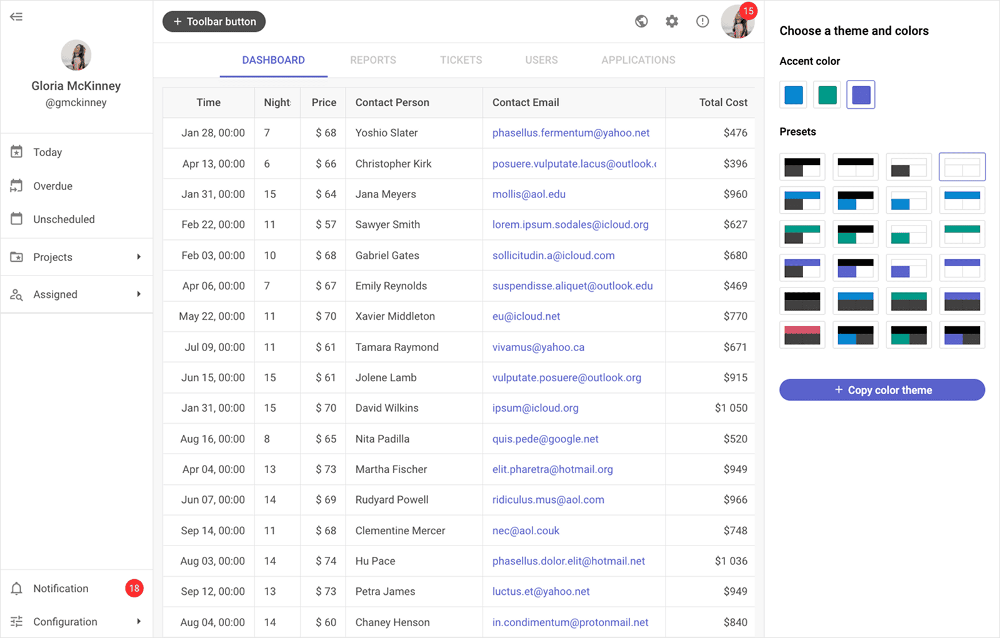

# DHTMLX Suite — JavaScript UI Widget Library (GPL Edition)

[](https://dhtmlx.com/)
[](https://dhtmlx.com/docs/products/dhtmlxSuite/)
[](https://www.gnu.org/licenses/old-licenses/gpl-2.0.html)


**DHTMLX Suite** is a JavaScript UI widget library with 20+ components for building data-intensive web applications – including a high-performance data grid, charts, forms, navigation controls, layout management, and data display widgets – all sharing a common API, theming system, and data layer.

It is a framework-agnostic library that works with plain JavaScript and integrates with React, Angular, Vue, and Svelte.

It is ideal for prototyping, embedding in open-source projects, and evaluating DHTMLX Suite features under the GPL-2.0 license.



---

## License

**This edition of DHTMLX Suite** is licensed under a GPL-2.0 license.

You can redistribute this package and/or modify it under the terms of the GPL v2.

GPL v2 requires that any project using this package also be open source under a GPL-compatible license.

**You may NOT use this package in closed-source, proprietary, or commercial applications** without a separate commercial license. For commercial use, please obtain a commercial license of DHTMLX Suite.

This package is distributed in the hope that it will be useful, but WITHOUT ANY WARRANTY; without even the implied warranty of MERCHANTABILITY or FITNESS FOR A PARTICULAR PURPOSE. See the GPL v2 for more details.

### Using DHTMLX Suite in a commercial or closed-source project?

You need a commercial license. DHTMLX offers Individual, Commercial, Enterprise, and Ultimate license tiers.

- [Compare licenses and pricing](https://dhtmlx.com/docs/products/licenses.shtml)
- [Download a free 30-day trial of DHTMLX Suite](https://dhtmlx.com/docs/products/dhtmlxSuite/download.shtml)
- [Download 30-day trial versions of all DHTMLX components](https://dhtmlx.com/docs/download/)
- Contact us regarding licensing: [info@dhtmlx.com](mailto:info@dhtmlx.com)

Copyright © 2026 XB Software Ltd.

---

## What is DHTMLX Suite

**DHTMLX Suite** is a JavaScript UI widget library of 20+ components for building data-intensive web and mobile applications. Its widgets cover data display (Grid with TreeGrid mode, Chart, DataView, List, Tree, Pagination), user input (Form with 15+ controls, ComboBox, ColorPicker, Slider, TimePicker, Calendar), layout and navigation (Layout, Tabbar, Toolbar, Ribbon, Menu, Sidebar, Popup, Window), and utility components (Message). All widgets share a unified DataCollection and TreeCollection API for loading, filtering, sorting, and manipulating data, four built-in themes (Light, Light Contrast, Dark, Dark Contrast), and a consistent event system and configuration pattern across the library.

This is the **GPL edition** of DHTMLX Suite, distributed as a downloadable ZIP archive. Some widgets – Calendar, Chart, Grid, and Tree – can be used as standalone components. All other widgets are tightly integrated with the Suite library and cannot be used outside of it.

Use this GPL edition for building production-ready web applications with full access to all DHTMLX Suite features.

---

## Quick Start

Include the JavaScript and CSS files in your HTML page, then initialize any Suite widget in a container element.

### Install

Extract the downloaded ZIP archive. The widget files are located in the `codebase/` directory.

### Include in your project

Add the JavaScript and CSS files to your HTML page:

```html
<script src="./codebase/suite.js"></script>
<link rel="stylesheet" href="./codebase/suite.css">
```

Or via CDN as part of DHTMLX Suite:

```html
<link rel="stylesheet" href="https://cdn.dhtmlx.com/suite/edge/suite.css" />
<script type="text/javascript" src="https://cdn.dhtmlx.com/suite/edge/suite.js"></script>
```

The CSS file is required for default suite styling and layout.

### Initialize a widget

All Suite widgets follow the same constructor pattern:

```js
const grid = new dhx.Grid("grid_container", {
    columns: [
        { id: "name",  header: [{ text: "Name" }],  width: 200 },
        { id: "role",  header: [{ text: "Role" }],  width: 150 },
        { id: "score", header: [{ text: "Score" }], width: 100 }
    ],
    data: [
        { id: "1", name: "Alice Johnson", role: "Engineer", score: 92 },
        { id: "2", name: "Bob Smith",     role: "Designer", score: 87 }
    ]
});
```

```html
<div id="grid_container" style="width: 100%; height: 400px;"></div>
```

[See live demos](https://snippet.dhtmlx.com/cwiuna9l?tag=suite)

---

## Basic Usage — DHTMLX Suite

### Building a layout with multiple widgets

Use Layout to arrange widgets in rows and columns, then attach Suite components to each cell:

```js
const layout = new dhx.Layout("layout_container", {
    rows: [
        { id: "toolbar", height: "content" },
        { id: "main",    cols: [
            { id: "sidebar", width: 220 },
            { id: "grid" }
        ]}
    ]
});

// Attach a Toolbar to the top row
const toolbar = new dhx.Toolbar(null, {
    data: [
        { type: "button", id: "add",    value: "Add",    icon: "dxi dxi-plus" },
        { type: "button", id: "export", value: "Export", icon: "dxi dxi-download" }
    ]
});
layout.getCell("toolbar").attach(toolbar);

// Attach a Tree to the sidebar
const tree = new dhx.Tree(null, {});
tree.data.parse([
    { id: "1", value: "Reports",   items: [
        { id: "1.1", value: "Q1" },
        { id: "1.2", value: "Q2" }
    ]},
    { id: "2", value: "Settings" }
]);
layout.getCell("sidebar").attach(tree);

// Attach a Grid to the main area
const grid = new dhx.Grid(null, {
    columns: [
        { id: "name",   header: [{ text: "Name" }] },
        { id: "status", header: [{ text: "Status" }] }
    ],
    data: []
});
layout.getCell("grid").attach(grid);
```

### Sharing data between widgets

Suite widgets share the DataCollection API. Load data once and bind it to multiple widgets:

```js
// other configuration (columns, series, etc.)
const data = new dhx.DataCollection();
data.load("/api/sales");

const grid = new dhx.Grid("grid_container", { columns, data });
const chart = new dhx.Chart("chart_container", {
    type: "bar",
    series,
    data
});
```

### Form with validation

Initialize a Form with multiple control types and validate before submit:

```js
const form = new dhx.Form("form_container", {
    rows: [
        { type: "input",    name: "name",  label: "Full name", required: true },
        { type: "input",    name: "email", label: "Email",     inputType: "email", required: true },
        { type: "select",   name: "role",  label: "Role",
          options: [
              { value: "admin",  content: "Admin" },
              { value: "editor", content: "Editor" }
          ]
        },
        { type: "checkbox", name: "agree", label: "I agree to terms", required: true },
        { type: "button",   text: "Submit", view: "flat", color: "primary" }
        }
    ]
});
```

---

## DHTMLX Suite Widgets

### Data display

| Widget | Description |
|:---|:---|
| **Grid** | High-performance data grid with sorting, filtering, inline editing, virtual scrolling, and data export to Excel, CSV, PDF, and PNG |
| **Grid with TreeGrid mode** | Hierarchical expandable/collapsible rows in Grid enabled via `type: "tree"` — **PRO only** |
| **Chart** | 13 chart types (line, bar, pie, donut, scatter, radar, area, heatmap, treemap, and more) with mixed series |
| **DataView** | Card-based display of data items with custom HTML templates per item |
| **List** | Vertical list with inline editing, drag-and-drop reordering, filtering, and sorting |
| **Tree** | Hierarchical tree view with checkboxes, drag-and-drop, inline editing, and lazy loading |
| **Pagination** | Page navigation control that connects to Grid, DataView, or List to page large datasets |

### User input

| Widget | Description |
|:---|:---|
| **Form** | Configurable form with 15+ control types: Input, Textarea, Select, Combo, Checkbox, RadioGroup, DatePicker, TimePicker, ColorPicker, Slider, Toggle, SimpleVault (file upload), and more |
| **ComboBox** | Searchable dropdown with grouping, multi-select, custom item templates, and remote data loading |
| **Calendar** | Date and date range picker with timepicker, disabled dates, localization, and three display modes |
| **TimePicker** | Standalone hour and minute selector with 12-hour and 24-hour formats |
| **ColorPicker** | Color selection widget with hex, RGB, and HSV input modes and custom color palettes |
| **Slider** | Range slider with tick marks, custom labels, and vertical/horizontal orientation |

### Layout and navigation

| Widget | Description |
|:---|:---|
| **Layout** | Flexible row/column layout manager; attach any Suite widget to any layout cell |
| **Tabbar** | Tab container; attach any Suite widget to each tab panel |
| **Toolbar** | Top navigation bar with buttons, dropdowns, separators, and custom controls |
| **Ribbon** | Office-style ribbon with grouped button blocks and nested controls |
| **Menu** | Context and navigation menu with nested submenus and keyboard navigation |
| **Sidebar** | Collapsible vertical sidebar with items and nested submenus |
| **Popup** | Floating popup container; attach any Suite widget or custom HTML to a Popup |
| **Window** | Movable, resizable modal and non-modal windows |

### Utility

| Widget | Description |
|:---|:---|
| **Message** | Toast, alert, and confirm dialog messages |

---

## DHTMLX Suite Library Features

| Feature | Details |
|:---|:---|
| Unified DataCollection API | Load, parse, filter, sort, and manipulate data across all widgets with a shared API |
| TreeCollection API | Hierarchical data management for Tree, TreeGrid, and Sidebar |
| Dynamic data loading | Lazy-load data on demand; virtual scrolling for large datasets in Grid and List |
| DataDrivers | Parse data from JSON, CSV, or XML into any widget |
| Four built-in themes | Light, Light Contrast, Dark, and Dark Contrast; switch theme at runtime |
| CSS variable theming | Customize every aspect of widget appearance via CSS variables |
| TypeScript support | Bundled TypeScript type definitions for all widgets and APIs |
| WAI-ARIA accessibility | WCAG-compliant; full keyboard navigation and screen reader support across all widgets |
| Touch support | Native touch events for mobile and tablet devices |
| Optimus micro-framework | Optional DHTMLX Optimus framework for building structured multi-widget apps with reusable views |
| Export modules | Export Grid, Chart, and DataView data to Excel, CSV, PDF, and PNG |
| Uploader API | File upload helper shared by Form's SimpleVault control and standalone use |
| Resizer | Drag handle for resizing adjacent layout panels |
| Event system | Consistent event model across all widgets |

---

## Framework Integration

DHTMLX Suite works with popular front-end frameworks including React, Angular, Vue, and Svelte. These integration guides apply to both the GPL edition and the commercial editions of DHTMLX Suite.

- [React integration guide](https://docs.dhtmlx.com/suite/integration/suite_and_react/)
- [Angular integration guide](https://docs.dhtmlx.com/suite/integration/suite_and_angular/)
- [Vue.js integration guide](https://docs.dhtmlx.com/suite/integration/suite_and_vue/)
- [Svelte integration guide](https://docs.dhtmlx.com/suite/integration/suite_and_svelte/)

---

## Documentation and Resources

- [Product page](https://dhtmlx.com/docs/products/dhtmlxSuite/) – overview, live demos, and key features.
- [Documentation](https://docs.dhtmlx.com/suite/) – getting started guides and API references for all 20+ widgets.
- [Live demos and samples](https://snippet.dhtmlx.com/cwiuna9l?tag=suite) – interactive code examples for every Suite widget.
- [Demo applications](https://dhtmlx.com/docs/products/demoApps/dhtmlxHotelManagement/) – real-world app templates built with Suite widgets.
- [Support forum](https://forum.dhtmlx.com/c/suite) – community Q&A and discussions for DHTMLX Suite.
